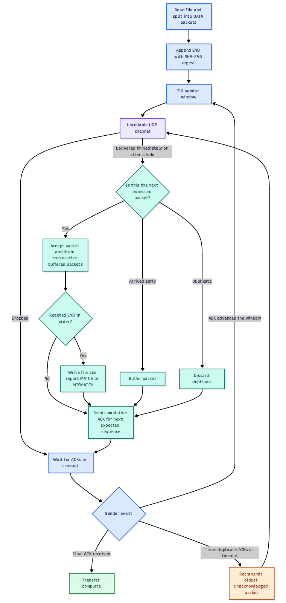

# Reliable UDP File Transfer

EECE 350 · Group 9

This project transfers a file over UDP and recovers from simulated packet loss
and reordering. The receiver checks the completed file against the sender's
SHA-256 hash.

## Part 1 — Packet format and channel (Ghadi Zouki)

protocol.py defines the DATA, ACK, and END packet formats. packetizer.py
splits the file into chunks of up to 1,024 bytes and adds an END packet with
the file's SHA-256 hash. channel.py simulates packet loss and reordering.

## Part 2 — Sender window and retransmission (Ali Hadi Zbeeb)

window.py limits how many packets can be in flight and advances the window
when a cumulative ACK arrives. It retransmits the oldest unacknowledged packet
after a timeout or three duplicate ACKs. sender.py connects the window to
the packetizer, channel, and UDP socket.

## Part 3 — Receiver and verification (Yara El Rohayem)

receiver.py buffers out-of-order packets and discards duplicates. Each ACK
gives the next expected sequence number. Once END arrives in order, the receiver
writes the file and reports MATCH or MISMATCH.

## Project flowchart

[](flowchart.pdf)

## Run

Use Python 3.9 or newer. In the first terminal, start the receiver.

```sh
python3 -u receiver.py --output received_file
```

In a second terminal, send a file from the same repository folder.

```sh
python3 -u sender.py CONTRACT.md --window 8 --loss 0.2 --reorder 0.25 --seed 1
cmp CONTRACT.md received_file
```

--window sets the maximum in-flight packets, --loss and --reorder set
the simulation probabilities, and --seed makes the simulator repeatable.
Restart the receiver before each transfer.
